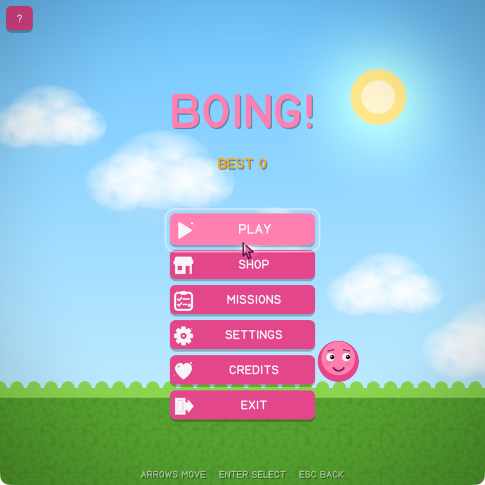
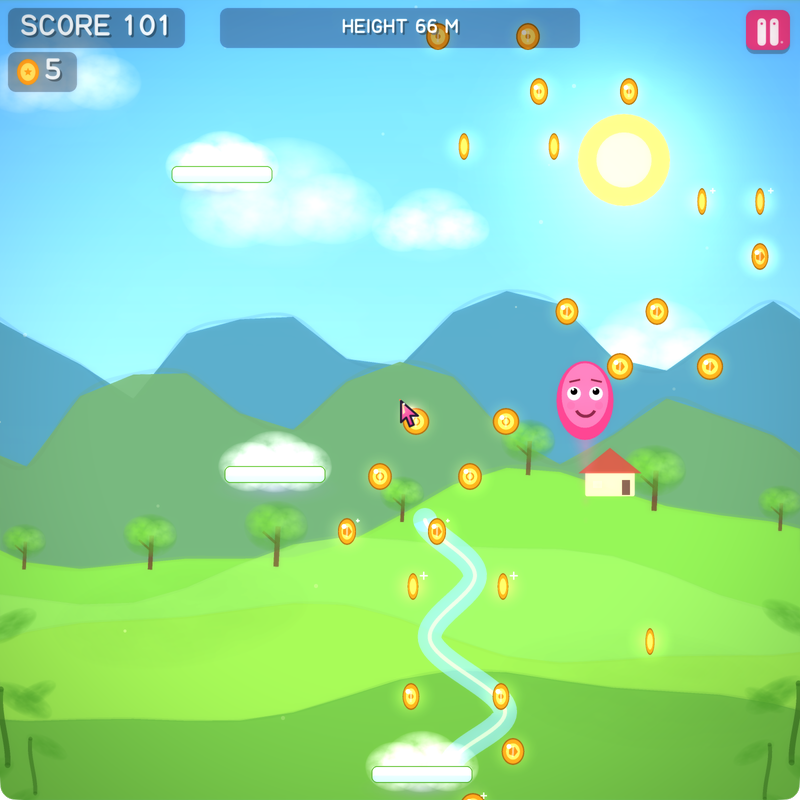

# Boing!

<p align="center">
  
  
</p>

**Boing!** is an original endless vertical jumper for macOS, written in C99 with [raylib](https://www.raylib.com/). Collect coins to bounce higher, land on platforms, avoid hazards, and keep climbing.

Boing! is **my first vibecoded app**. It grew from a small experiment into a complete game with original code, art, audio, and game design.

The game was created for the [2PG Arcade 1.44MB Contest](https://2pgarcade.com/contest-144mb.html). Its Universal 2 app bundle supports Apple Silicon and Intel Macs while fitting within one 1.44 MB floppy disk: **1,455,107 bytes** decompressed.

## Play

- Move with the arrow keys or mouse.
- Collect coins to gain height and build combos.
- Land on platforms and dodge monsters, falling pieces, and debuffs.
- Falling below the screen ends the run.
- Spend collected coins on outfits and power-up upgrades.

Seven looping eras change both the presentation and the rules:

| Era | Rule |
| --- | --- |
| Sunny Hills | Classic cloud-platform jumping |
| Birdsong Skies | Platforms drift with the wind |
| Night Blocks | Landed platforms crack and crumble |
| Neon Maze | Pellets frighten pursuing ghosts |
| Falling Blocks | Descending tetrominoes are platforms and hazards |
| Magma Forge | Charged vents erupt into stronger jumps |
| Reboot Garden | Falling seedbeds root into safe platforms |

## Made to fit

Music, sound effects, backgrounds, textures, icons, and the vector font are generated or embedded in code. The only bundled asset is the original macOS app icon. [raylib](https://github.com/raysan5/raylib) and [nanosvg](https://github.com/memononen/nanosvg) are pinned as git submodules and linked statically.

## Build

Requires macOS 11 or later, CMake, and the Xcode Command Line Tools.

```sh
git clone --recurse-submodules https://github.com/Hiyabye/Boing.git
cd Boing
cmake -S . -B build
cmake --build build
open build/Boing.app
```

## Originality

Boing! takes genre inspiration from [Mega Jump](https://www.halfbrick.com/games/megajump) by Halfbrick, but is not affiliated with it. All game-specific code, art, audio, names, layouts, and tuning are original.

## License

Boing! is released under the [zlib license](LICENSE). Third-party license notices are included with the app bundle.
